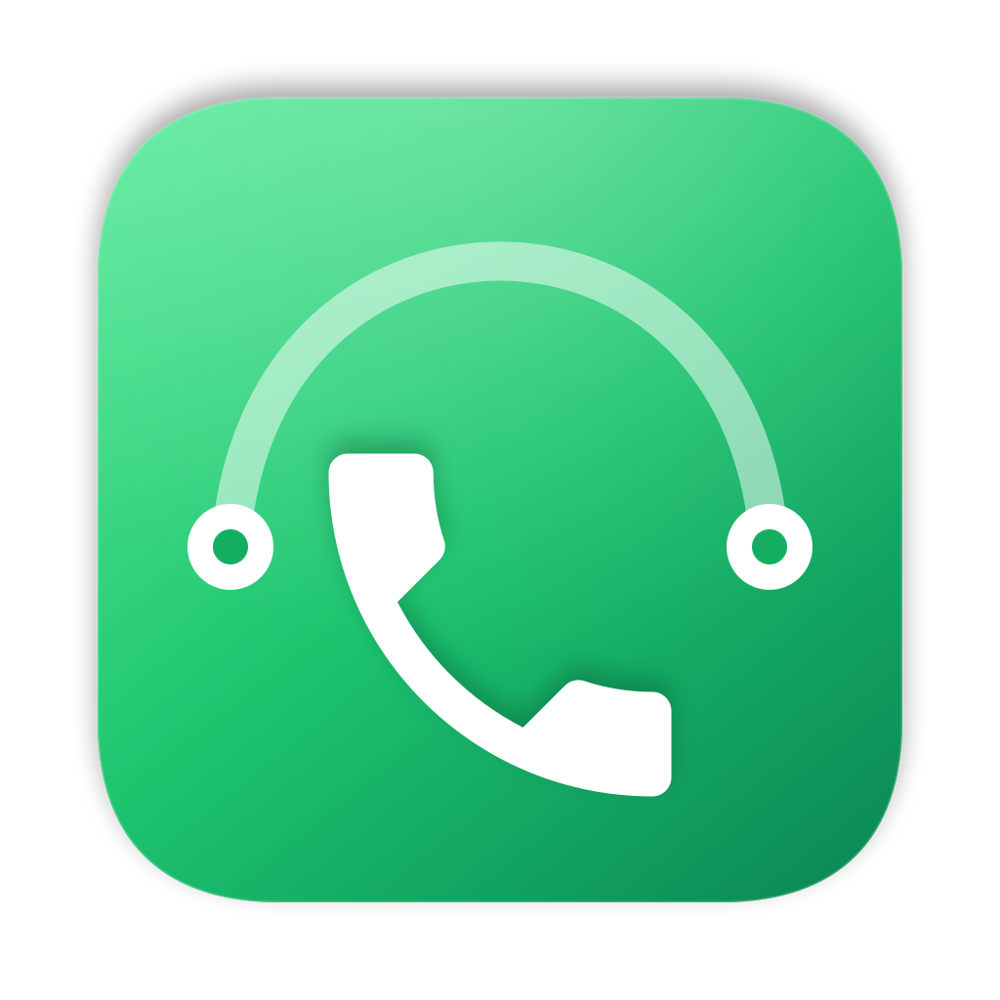

<p align="center"></p>

# PhoneBridge

PhoneBridge is a macOS app that controls the calls of an Android phone from a Mac. It connects to the phone over Bluetooth as a hands-free device, the same way a car kit does. You can see who is calling, answer, decline, dial, and hang up on the Mac.

The call voice stays on the phone. macOS does not let third-party apps carry Bluetooth call audio, so you talk through the phone or a headset connected to it. The research report explains why.

## Features

- Incoming calls show a floating call panel with the caller's number or contact name, and Accept and Decline buttons.
- The Mac rings with an Apple ringtone of your choice. It rings on the current sound output and on the Mac speakers.
- You can dial from the keypad, from your contacts, or from the call list.
- The in-call keypad sends tones to automated phone menus and shows the digits that you pressed.
- The call list records incoming, outgoing, and missed calls, with contact names from the Contacts app.
- If the phone drops the Bluetooth link, the app reconnects by itself.
- If more than one phone is paired with the Mac, you choose the phone from the sidebar or the Phone menu. The app remembers your choice.
- `tel:` links from Safari, Contacts, and Calendar open the PhoneBridge keypad.

## Requirements

- A Mac with Bluetooth and macOS 14 or later. The app was tested on macOS 27 on Apple silicon.
- An Android phone paired with the Mac. The app was tested with a OnePlus 7T on Android 12 and a Redmi Note 10 Pro.

## Install

1. Download `PhoneBridge-1.1.0.dmg` from the [latest release](../../releases/latest) and open it. The release also has the same app as `PhoneBridge-1.1.0.zip`.
2. Drag PhoneBridge to the Applications folder.
3. The app is signed ad hoc and is not notarized by Apple. On first launch, right-click the app and choose Open. If macOS still blocks it, run this command once:

   ```bash
   xattr -dr com.apple.quarantine /Applications/PhoneBridge.app
   ```

4. If your phone is not paired with the Mac, pair it in System Settings > Bluetooth.
5. Open PhoneBridge and allow Bluetooth access. If you want contact names, also allow Contacts access.

While the phone is connected, the status card at the bottom of the sidebar shows the phone's name, signal, and battery.

## Build from source

You need the Xcode Command Line Tools.

```bash
cd phone-bridge && ./build.sh
```

The app is built at `phone-bridge/build/PhoneBridge.app`.

To make the installer disk image, run `phone-bridge/dmg/make-dmg.sh` after the build. The image is built at `phone-bridge/build/PhoneBridge-<version>.dmg`.

The icon is prebuilt in `phone-bridge/icon/compiled`. If you change the icon, run `phone-bridge/icon/make-icon.sh`. That script needs the full Xcode, for the `actool` tool.

## How it works

- The app uses the public `IOBluetoothHandsFreeDevice` API of macOS for the hands-free (HFP) control link.
- Some phones advertise the hands-free service on the wrong RFCOMM channel (a numbered Bluetooth serial channel). The OnePlus 7T advertises channel 1 but listens on channel 3. PhoneBridge finds the channel that answers and remembers it.
- Test commands can be written one per line to `~/Library/Logs/PhoneBridge/cmd.txt`. The app log is `~/Library/Logs/PhoneBridge/app.log`.

## Limits

- Call audio does not go through the Mac. macOS refuses the Bluetooth voice link (SCO) for third-party apps, and Android does not give call audio to apps. [call-audio-setup.md](call-audio-setup.md) describes a setup with a USB Bluetooth adapter and a Linux VM that carries the audio.
- The native macOS Phone app cannot take Android calls. It uses a private Apple protocol that works only with an iPhone.

## Repository contents

| Path | Contents |
| --- | --- |
| `phone-bridge/` | The PhoneBridge app: Swift sources, build script, and icon |
| `hfp-probe/` | The menu-bar test tool used to check the hands-free link before the app was built |
| `android-calls-on-mac-report.md` | Research report: architecture, test results, and limits |
| `call-audio-setup.md` | Setup guide for call audio with a second Bluetooth radio |

## License

PhoneBridge is released under the [MIT License](LICENSE).

## Credits

The handset in the icon is the "call" glyph from Google's Material Design icons, under the Apache License 2.0.
